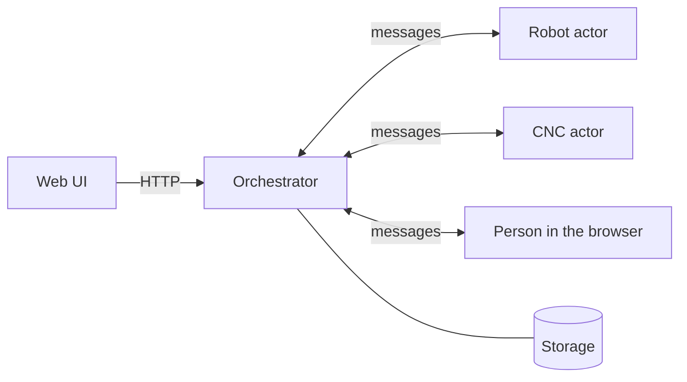

# Concepts

Antikythera runs processes that are made of many steps, done by different machines and
people. This page explains the words the rest of the documentation uses.

## Blueprint

A **blueprint** describes a process: the tasks to do, and the order to do them in. It is
written in JSON, or built in Python. A blueprint does not run by itself; it is a plan.

## Task

A **task** is one step of a blueprint, for example "pick up the beam" or "ask the operator
to confirm". Each task has:

- an **id**, unique in the blueprint.
- a **type**, which says who does the task. The type `robot.pick` means: the `pick` tool
  of the `robot` actor.
- **inputs**: the values the task needs.
- **outputs**: the values the task produces.
- **params**: fixed settings, like how many seconds to wait.
- **dependencies**: the tasks that must finish before this one starts.

Every blueprint starts with one `system.start` task and ends with one `system.end` task.
Every other task depends on at least one task.

## Actor and tool

An **actor** is a program that does tasks. It can control a machine, run a calculation,
or show a question to a person. Each actor has an **actor type**, like `robot`.

A **tool** is one job an actor can do. In Python, a tool is a method of the actor class.
A task of type `robot.pick` is done by the `pick` tool of an actor of type `robot`.

Several actors of the same type can run at the same time, for example two identical
robots. Each task goes to only one of them, unless the task says otherwise (see
[competitive execution](#more-features)).

Antikythera comes with some actors:

| Actor type | Tools | Runs in |
| --- | --- | --- |
| `system` | `start`, `end`, `sleep`, `composite` | Python, always needed |
| `io` | `copy` (copy files) | Python |
| `user_interaction` | `user_input`, `user_output`, `notify` (in the terminal) | Python |
| `user_prompt` | `confirm` (a question with buttons) | The web UI |
| `notification` | `notify` | The web UI |

You write actors for your own machines. See [Writing actors](actors.md).

## Session

A **session** is one run of a blueprint. You can run the same blueprint many times; each
run is a new session with its own state and data.

Each session has **session data**: a shared table of named values. When a task finishes,
its outputs are saved there by name. When a task starts, its inputs are read from there
by name. This is how the result of one task reaches the next one. See
[Writing blueprints](blueprints.md) for the details.

## Orchestrator

The **orchestrator** runs a session. It:

1. starts every task whose dependencies have finished,
2. sends the task to the actors of the right type, with its inputs,
3. gives the task to the first actor that claims it,
4. saves the outputs the actor sends back, and moves on.

Each task goes through these states: `PENDING` (waiting for dependencies), `READY` (sent to
actors), `RUNNING` (an actor is working on it), and finally `SUCCEEDED`, `FAILED` or
`SKIPPED`.

The orchestrator usually runs as a service with an HTTP API. The web UI uses this API to
upload blueprints, start sessions and watch them run. The orchestrator can also run inside
your own Python program, as in the [hello world](index.md#hello-world). See
[Embedding the orchestrator](embedding.md).

## Transport and storage

The orchestrator and the actors talk by sending messages. The **transport** carries them.
By default it is an MQTT broker, so actors can run on any machine that can reach the
broker. [NATS](nats.md) and [Zenoh](zenoh.md) can be used instead.

The **storage** keeps blueprints, sessions and session data. By default it is Redis, so
nothing is lost when the orchestrator restarts. NATS and Zenoh can keep the data as well,
and an in-memory storage is useful for tests and small programs.

## More features

These are covered by the [examples](examples.md):

- **Conditions**: a task runs only if a condition on the session data is true.
- **Scopes**: a group of tasks that is skipped, retried, or repeated while a condition is true.
- **Composite tasks**: a task that runs another blueprint, like a function call.
- **Dynamic expansion**: a composite task that runs its blueprint once per element of a
  [COMPAS model](https://github.com/blockresearchgroup/compas_model), for example once
  per beam of a timber structure.
- **Competitive execution**: a task is sent to all actors of its type, and the first one
  to finish wins.
