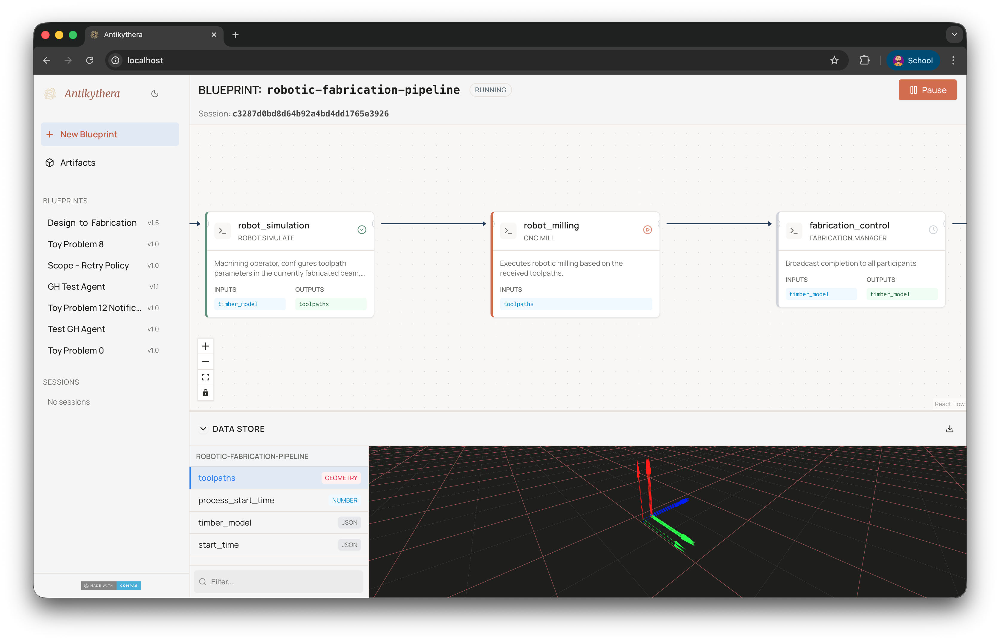

# Antikythera

<p align="center">
  
</p>

<p class="lead" align="center">
An all knowing, all controlling, robotic and otherwise, process manager.
</p>

Antikythera runs fabrication processes. You describe a process as a **blueprint**: a list
of tasks and the order to do them in. **Actors** do the tasks: a robot, a CNC machine, a
script, or a person answering a question in the browser. The **orchestrator** hands each
task to an actor when it is ready to start, and keeps track of the results.

Actors can run on different machines. The orchestrator and the actors talk over a network,
so one process can use a robot in the workshop, a computer next to a machine, and a person
with a tablet.

## Hello, world

Install the SDK:

```bash
pip install antikythera-sdk
```

Save this as `hello_world.py`:

```python
--8<-- "examples/hello_world.py"
```

Run it:

```console
$ python hello_world.py
🏃 [system.start] Starting...
✅ [system.start] Finished.
🏃 [system.end] Starting...
✅ [system.end] Finished.
Hello, world!
```

`@tool("greeter.hello")` makes the function `hello` the `hello` tool of the `greeter`
**actor**. The **blueprint** has one task, `greet`, of type `greeter.hello`, so that tool
does it. The `with` block also adds a `start` and an `end` task: every blueprint begins and
finishes with them, and Antikythera runs both itself. The tool's return value is saved as
the task's `greeting` output, and the program reads it back at the end.

Here, everything runs in one Python process. In a real setup, the orchestrator runs as a
service with a web UI, and actors connect to it from other machines.

## Next steps

- [Concepts](concepts.md) explains blueprints, tasks, actors and the orchestrator.
- [Run with Docker](deployment/docker.md) starts the full system, with the web UI, in two commands.
- [Writing actors](actors.md) shows how to connect your own machines and code.
- [Writing blueprints](blueprints.md) shows how to describe a process.
- [Examples](examples.md) lists blueprints that show each feature.
